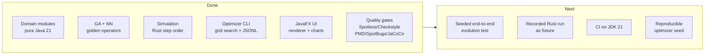

# ROADMAP - JShorelark

Milestones for a faithful Java 21 / JavaFX port of
[Shorelark](https://codeberg.org/pwy/shorelark). The companion diagram is [`ROADMAP.mmd`](ROADMAP.mmd);
open work items live in [`TO-DO.md`](TO-DO.md).

## Where we are

The port is **functionally complete and faithful**: all four Rust crates have a Java counterpart,
`mvn -B -ntp verify` is green across the seven modules, and the vision geometry is pinned by a port
of the reference `eye.rs` test suite. What remains is confidence, not features.

## Milestone 1 - Faithful domain (done)

Goal: every rule lives in one place and matches Rust line for line.

- `genetic-algorithm`: `Chromosome`, `Individual`, roulette-wheel selection with the `0.00001f`
  fitness floor, uniform crossover at `0.5`, Gaussian mutation, median for even populations.
- `neural-network`: layered feed-forward network, ReLU, weight flattening as
  `[bias, w0, w1, …]` per neuron, per layer.
- `simulation`: toroidal unit world, segmented eye, brain output scaling
  (`[0,2] → [-1,1]` then the acceleration clamps), collision radius from `Config#foodSize`,
  generation trigger on `age > simGenerationLength`, step order
  collisions → brains → movement → evolve.
- Rust reference tests ported: eye vision grids, neuron propagation, GA statistics, GA golden
  output.

Exit criteria met: `verify` green, ≥ 80 % line coverage on the three domain modules.

## Milestone 2 - Fidelity hardening (in progress)

Goal: make a future regression in *behaviour* fail the build, not just a regression in *units*.

- [ ] Seeded end-to-end evolution test: fix the seed and a tiny configuration, run a handful of
  generations, assert the fitness trajectory.
- [ ] Fixture recorded from the Rust optimizer, asserted here, so `f32` details and operator order
  are locked together.
- [ ] Document, with a number, what "learning works" looks like (median fitness after N
  generations) so the optimizer has a baseline to compare against.

## Milestone 3 - Reproducibility

Goal: a grid search can be replayed.

- [ ] `--seed` on `simulate`, deriving a per-configuration `Random` from it.
- [ ] Row order and CSV output already deterministic (`TreeMap` + explicit comparator); keep it
  that way and test it.
- [ ] Log the resolved grid, not only the results, so an analysis can be reproduced from the log
  alone.

## Milestone 4 - CI and delivery

Goal: the gates run where the code is reviewed.

- [x] One CI job on JDK 21 running `mvn -B -ntp verify` (Spotless, Checkstyle, SpotBugs, PMD/CPD,
  JaCoCo), with the reports uploaded on failure.
- [x] Matrix on Windows and Linux: the primary developer platform is Windows, CI is Linux, and
  line-ending or JavaFX packaging differences should surface there.
- [ ] Optional: publish Javadoc and the AsciiDoc architecture document.

## Milestone 5 - Experience (adapter only)

Goal: make the simulator teach, without letting the domain drift from Rust.

- [ ] Split the bird inspector out of `SimulationView`.
- [ ] Externalise UI strings.
- [ ] Optional `TANH` activation behind the existing `sealed` `ActivationFunction`, off by default,
  to let readers of the blog series compare ReLU and `tanh` on the same birds.

## Non-goals

- **Backpropagation.** Shorelark evolves weights; it never trains them. Part 3 of the series is
  background, not a requirement.
- **Elitism, speciation, novelty search.** Interesting, but any of them changes the reference
  behaviour and must stay behind a non-default configuration.
- **A web build.** The Rust project ships WASM; this port targets the desktop JVM.
